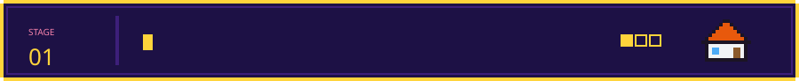
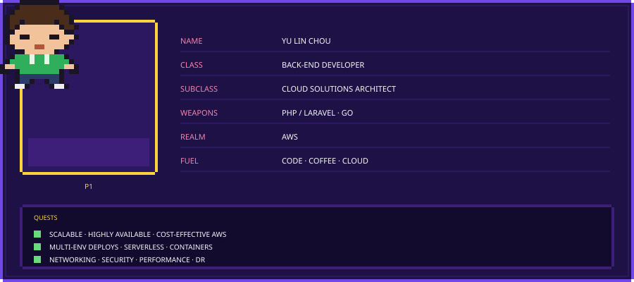
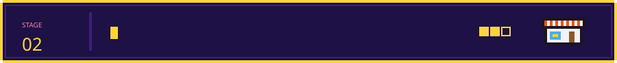
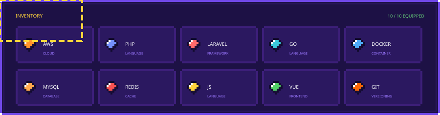
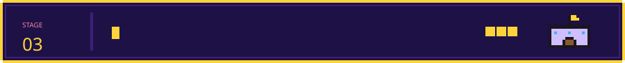

<!-- ============================================================
     YU LIN QUEST — side-scrolling platformer profile
     All pixel art and animation live in ./assets (self-contained SVG)
     ============================================================ -->

  

  
  &nbsp;
  
  &nbsp;
  

  

<!-- STAGE 01 · ORIGIN -->

  
  

<!-- STAGE 02 · ITEM SHOP -->

  
  

<!-- STAGE 03 · CLOUD CASTLE -->

  

<table>
  <!-- Pixel bar: its large intrinsic width stretches GitHub's max-content table to 100% -->
  <tr>
    <td colspan="2"></td>
  </tr>
  <tr>
    <td align="center" width="22%"><b>★★★</b> <b>BOSS</b> PROFESSIONAL</td>
    <td align="center">
      
      &nbsp;&nbsp;
      
    </td>
  </tr>
  <tr>
    <td align="center"><b>★★</b> <b>MINI-BOSS</b> ASSOCIATE</td>
    <td align="center">
      
      &nbsp;&nbsp;
      
      &nbsp;&nbsp;
      
      &nbsp;&nbsp;
      
    </td>
  </tr>
  <tr>
    <td align="center"><b>★</b> <b>WARM-UP</b> FOUNDATIONAL</td>
    <td align="center">
      
      &nbsp;&nbsp;
      
    </td>
  </tr>
</table>

  

