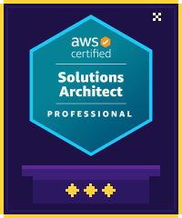
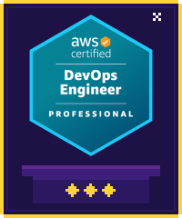
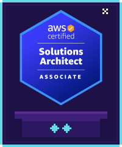
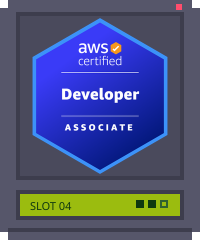
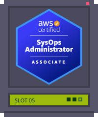
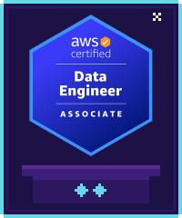
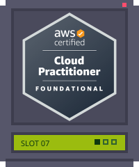
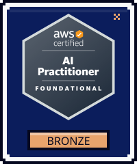

<!-- ============================================================
     YU LIN QUEST — side-scrolling platformer profile
     All pixel art and animation live in ./assets (self-contained SVG)
     ============================================================ -->

  

  
  &nbsp;
  
  &nbsp;
  

  

<!-- STAGE 01 · ORIGIN -->

  
  

<!-- STAGE 02 · ITEM SHOP -->

  
  

<!-- STAGE 03 · CLOUD CASTLE -->

  

<!-- CERTS:START -->

  

  
  

  

  
  
  
  

  

  
  

<!-- CERTS:END -->

  

