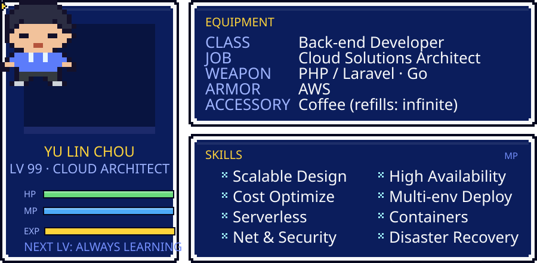
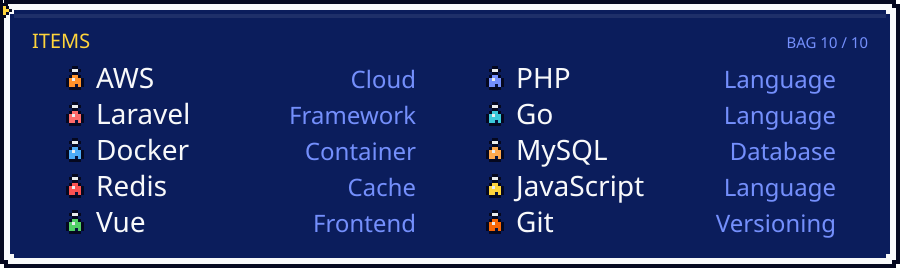

<!-- ============================================================
     THE CLOUD ARCHITECT — turn-based RPG profile
     All pixel art and animation live in ./assets (self-contained SVG)
     ============================================================ -->

  

  
  
  

  

  

  

<!-- CERTS:START -->

  

  
  

  

  
  
  
  

  

  
  

<!-- CERTS:END -->

  

